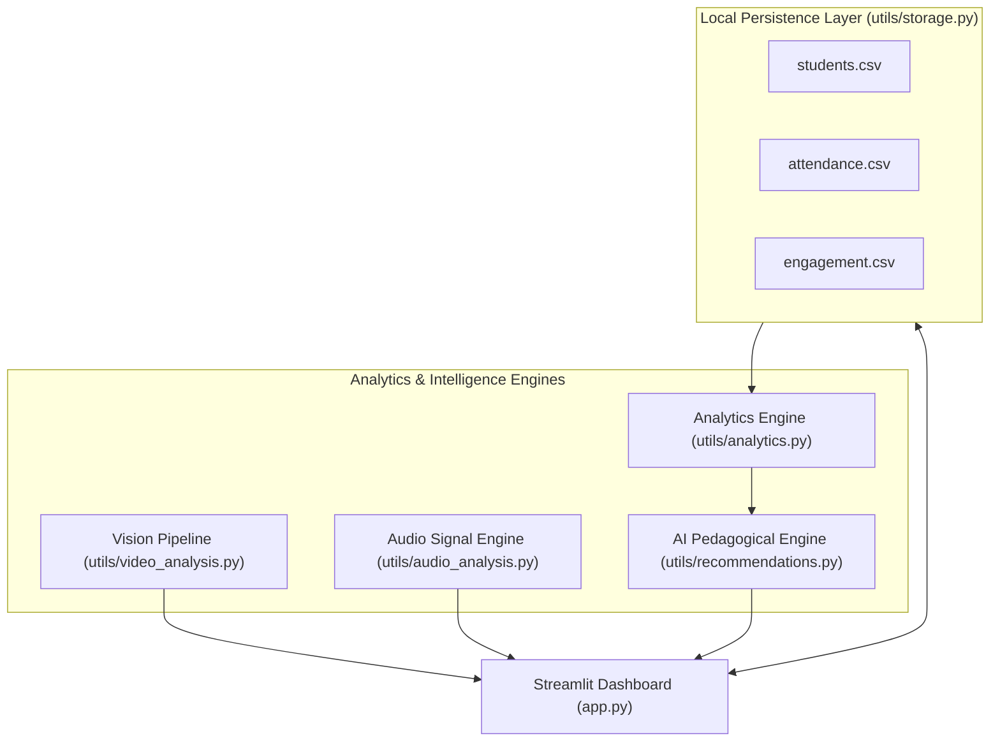

# ClassPulse AI — Attendance & Engagement Intelligence

> **Smart classroom analytics powered by computer vision and AI-assisted insights.**

ClassPulse AI is an AI-powered classroom attendance and engagement analytics application designed to help educators monitor student attendance records, evaluate multimodal classroom engagement indicators (visual face presence proxy and audio acoustic dynamics), calculate attendance statistics, and generate actionable, evidence-backed teaching interventions—all running **100% locally with zero cloud API keys, zero paid subscriptions, and complete data privacy**.

---

## Table of Contents
1. [Core Features](#core-features)
2. [Technology Stack](#technology-stack)
3. [Architecture Overview](#architecture-overview)
4. [Project Structure](#project-structure)
5. [Quickstart Guide (Local Run)](#quickstart-guide-local-run)
6. [Feature Walkthrough](#feature-walkthrough)
7. [Ethical Scope & Scientific Disclaimers](#ethical-scope--scientific-disclaimers)
8. [Automated & Manual Testing](#automated--manual-testing)
9. [Publishing to GitHub](#publishing-to-github)
10. [Cloud Deployment Options](#cloud-deployment-options)

---

## Core Features

* **Real-Time Attendance Intelligence:** Roster enrollment, bulk attendance marking (Present/Absent/Late), instant calculation of attendance percentages:
  $$\text{Attendance Rate (\%)} = \left(\frac{\text{Present Students}}{\text{Total Students}}\right) \times 100$$
* **Multimodal Engagement Indicators:** Transparent composite scoring engine combining visual presence rates, acoustic activity dynamics, interactive responses, and punctuality.
* **Video Frame Analysis:** Lightweight local computer vision pipeline. Samples video frames, runs face detection (MediaPipe or built-in OpenCV Haar Cascades), draws visual bounding boxes, and computes optical presence rates without external internet access.
* **Audio Acoustic Analysis:** Reads classroom audio waveforms, computes Root Mean Square (RMS) energy envelopes, and categorizes periods of discussion versus quiet study using local SciPy and Python audio processing.
* **Local AI Teaching Assistant:** Deterministic, rule-based pedagogical engine providing tailored teaching recommendations, observational rationale, and concrete next actions based on real classroom data.
* **Zero-Cloud Local Storage:** Automated CSV persistence for students, attendance history, and engagement logs with demo-data isolation and reset functionality.
* **Certified Exports & Print Ready Reports:** Instant CSV download buttons and browser-printable executive HTML report cards.

---

## Technology Stack

* **Language:** Python 3.10+ (Tested on Python 3.12)
* **Frontend / Dashboard:** [Streamlit](https://streamlit.io/) (Responsive web UI with custom Blue/Slate styling)
* **Data Processing & Analytics:** [Pandas](https://pandas.pydata.org/), [NumPy](https://numpy.org/)
* **Visualization:** [Matplotlib](https://matplotlib.org/) (Agg non-GUI backend)
* **Computer Vision:** [OpenCV](https://opencv.org/) (`cv2` Haar Cascade offline detector) & optional [MediaPipe](https://developers.google.com/mediapipe)
* **Audio Analysis:** [SciPy](https://scipy.org/) (`scipy.io.wavfile`), Python `wave`, and optional [Librosa](https://librosa.org/)
* **Storage:** Clean local CSV flat files (`data/*.csv`)

---

## Architecture Overview



---

## Project Structure

```text
classpulse-ai/
├── app.py                     # Streamlit application entry point & 8 dashboard pages
├── requirements.txt           # Verified, compatible Python dependencies
├── run.bat                    # One-click Windows launch and environment activation
├── test_app.py                # Comprehensive automated unit test suite
├── README.md                  # Complete documentation and setup manual
├── data/                      # Local CSV storage directory
│   ├── students.csv           # Registered student records
│   ├── attendance.csv         # Session attendance logs
│   └── engagement.csv         # Historical engagement records
└── utils/                     # Modular backend utilities
    ├── __init__.py            # Package descriptor
    ├── storage.py             # CSV CRUD operations & default demo seeders
    ├── analytics.py           # Statistical aggregation & composite scoring
    ├── video_analysis.py      # Video decoding, sampling & face detection
    ├── audio_analysis.py      # Audio signal reading, RMS energy & activity classification
    └── recommendations.py     # Deterministic pedagogical recommendation rules
```

---

## Quickstart Guide (Local Run)

### Method 1: One-Click Run on Windows
Double-click `run.bat` or run in Command Prompt / PowerShell:
```cmd
run.bat
```
This script will verify your Python environment, install any missing core dependencies, and start Streamlit on `http://localhost:8501`.

### Method 2: Manual Terminal Setup

1. **Navigate to the project directory:**
   ```bash
   cd "C:\Users\WIN 10\.gemini\antigravity\scratch\classpulse-ai"
   ```

2. **(Optional) Create and activate a virtual environment:**
   ```bash
   python -m venv .venv
   # Windows PowerShell:
   .venv\Scripts\Activate.ps1
   # Windows Command Prompt:
   .venv\Scripts\activate.bat
   # Linux / macOS:
   source .venv/bin/activate
   ```

3. **Install required packages:**
   ```bash
   pip install -r requirements.txt
   ```

4. **Launch the application:**
   ```bash
   streamlit run app.py
   ```
5. Open your browser at `http://localhost:8501`.

---

## Feature Walkthrough

### 1. Dashboard
* Real-time KPI summary: Total Students, Latest Session Present/Absent, Overall Attendance Rate, Engagement Score, and Total Sessions.
* Attendance status pie chart and session-wise engagement progression chart.
* Recent attendance activity log with colored status pills (`Present`, `Absent`, `Late`).

### 2. Student Management
* **Enroll:** Add new students with ID, Full Name, Class/Section, and optional Email. Duplicate IDs are automatically rejected.
* **Edit/Delete:** Update student profiles or remove inactive entries.
* **Search & Filter:** Search by name/ID, filter by class, or toggle between real and demo records.

### 3. Attendance Management
* Select session date and title.
* Mark individual student status or use one-click shortcuts (`Mark All Present`, `Mark All Absent`).
* Live attendance percentage meter: updates in real-time as checkboxes/radios change.
* Historical records viewer with date and session filters.

### 4. Engagement Analytics
* **Interactive Evaluator:** Adjust indicators for visual presence, acoustic activity, interactive quiz participation, and on-time arrival.
* **Configurable Weights:** Adjust weight sliders to customize the composite formula.
* Log session metrics directly into persistent history.

### 5. Video Analysis
* Upload `.mp4`, `.avi`, or `.mov` clips, or click **"Load Demo Classroom Video Simulator"** for instant testing without an external video file.
* Samples evenly distributed frames across the video.
* Detects faces with bounding boxes drawn in blue.
* Displays total frames, frames with faces, and optical presence percentage.

### 6. Audio Analysis
* Upload `.wav` or `.mp3` files, or click **"Load Demo Classroom Audio Simulator"**.
* Computes and plots the continuous normalized waveform and RMS energy curve.
* Identifies relative acoustic activity levels (High Discussion, Moderate Speech, Quiet/Silence).

### 7. AI Teaching Assistant
* Analyzes actual class records to provide 4-part pedagogical cards:
  1. **Observed Data:** Factual metrics that triggered the rule.
  2. **Recommendation:** Actionable teaching intervention.
  3. **Reason:** Evidence-backed cognitive and pedagogical rationale.
  4. **Next Action:** Step-by-step classroom implementation.
* Includes an interactive **Scenario Simulator** to test engine logic under arbitrary simulated classroom conditions.

### 8. Reports & Export
* Download certified CSV files: `Attendance Log`, `Engagement Log`, and `Student-Wise Summary`.
* Printable executive report card view (ready for `Ctrl+P` export to PDF).
* Storage maintenance controls to reset demo datasets.

---

## Ethical Scope & Scientific Disclaimers

1. **Optical Presence Only:** Visual face detection is strictly an objective proxy of optical presence within the camera's field of view. The system **does NOT perform facial recognition, biometric identity identification, or verify individual student identity**.
2. **No Emotion or Comprehension Inferences:** Neither visual nor acoustic indicators claim to measure emotional state, facial expressions, student cognitive attention, internal comprehension, or academic capability.
3. **Transparent Heuristics:** Engagement scores are transparently calculated weighted composites of observable classroom indicators (e.g., punctuality, participation rate, sound energy). They are clearly labeled as observational indicators, not individual student performance metrics.
4. **Data Sovereignty:** All processing runs locally. No classroom video frames, audio clips, or student rosters are ever sent to external cloud APIs or third-party servers.

---

## Automated & Manual Testing

### Automated Test Suite
Run the included test suite to verify storage persistence, calculation safety, empty dataset handling, and analytics:
```bash
python test_app.py
```
**Test Coverage:**
* Storage initialization and default demo data seeding
* Student enrollment, duplicate ID prevention, editing, and deletion
* Attendance percentage formula: `(Present / Total) * 100`
* Safe handling of empty datasets without division-by-zero errors
* Engagement composite scoring and classification thresholds
* Video pipeline and Haar Cascade face detection fallback
* Audio waveform processing and RMS energy computation
* Deterministic recommendation rules under various classroom scenarios

### Manual Verification Checklist
- Launch `app.py` via `streamlit run app.py` and navigate across all 8 sidebar tabs.
- Enroll a new student `STU-205` in Student Management; confirm duplicate check rejects duplicate `STU-205`.
- Mark attendance for today's session; verify attendance percentage updates dynamically.
- Click "Load Demo Classroom Video Simulator" in Video Analysis; verify bounding boxes render properly on frames.
- Click "Load Demo Classroom Audio Simulator" in Audio Analysis; verify dual waveform and RMS plots render cleanly.
- Review AI Teaching Assistant tab; test scenario sliders in simulator.
- Download all 3 CSV exports from Reports & Export; inspect column names and values.

---

## Publishing to GitHub

To publish this project to GitHub:

```bash
cd "C:\Users\WIN 10\.gemini\antigravity\scratch\classpulse-ai"

# Initialize Git repository
git init

# Configure .gitignore
echo __pycache__/ > .gitignore
echo *.pyc >> .gitignore
echo .venv/ >> .gitignore
echo *.mp4 >> .gitignore
echo *.wav >> .gitignore

# Stage and commit files
git add .
git commit -m "feat: initial commit of ClassPulse AI multimodal attendance & engagement platform"

# Link to your GitHub repository (replace with your repo URL)
git branch -M main
git remote add origin https://github.com/<YOUR_USERNAME>/classpulse-ai.git
git push -u origin main
```

---

## Cloud Deployment Options

Although built to run locally without cloud credentials, you can easily deploy ClassPulse AI to public cloud hosting platforms:

### Option 1: Streamlit Community Cloud (Recommended Free Hosting)
1. Push your repository to GitHub.
2. Sign in to [share.streamlit.io](https://share.streamlit.io/) with your GitHub account.
3. Click **"New App"**, select repository `classpulse-ai`, branch `main`, and main file `app.py`.
4. Click **Deploy**. Your app will be live with a public URL in 2 minutes.

### Option 2: Hugging Face Spaces (Streamlit SDK)
1. Create a new Space on [huggingface.co/spaces](https://huggingface.co/spaces) selecting the **Streamlit** SDK.
2. Push your files to the Hugging Face Git remote.
3. Hugging Face automatically installs `requirements.txt` and serves the app.

---

## License
This project is open-source under the MIT License.
